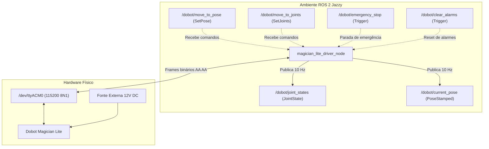

# Driver ROS 2 Jazzy para Dobot Magician Lite

Este repositório contém a implementação completa e nativa de um driver ROS 2 Jazzy (Ubuntu 24.04 / Python 3.12) para comunicação, leitura de telemetria em tempo real e controle de movimentação do braço robótico **Dobot Magician Lite** físico conectado via USB.

---

## 1. Visão Geral e Arquitetura

Diferente do Dobot Magician clássico (que utiliza ponte serial CP210x em `/dev/ttyUSB*` e bibliotecas compiladas C legadas `libDobotDll.so`), o **Dobot Magician Lite** opera com uma controladora STM32 via USB CDC-ACM (`/dev/ttyACM0`) e geometria mecânica própria.

A solução foi desenvolvida de forma 100% nativa em Python (`rclpy` + `pyserial`), comunicando-se diretamente através do **Dobot Communication Protocol v1.x**. Isso elimina conflitos de dependências de ABI/glibc no Ubuntu 24.04 e garante compatibilidade transparente com o ecossistema ROS 2 Jazzy.



### Estrutura do Repositório:
* [src/magician_lite_msgs](src/magician_lite_msgs): Pacote `ament_cmake` com as definições de serviços de movimentação cartesiana e articular.
* [src/magician_lite_driver](src/magician_lite_driver): Pacote `ament_python` com o driver ROS 2, parser de protocolo Dobot, mutex serial e validações de segurança.
* [scripts/test_dobot_pose.py](scripts/test_dobot_pose.py): Script de diagnóstico serial independente (sem dependência de ROS) para testar a conexão do robô.

---

## 2. Requisitos de Hardware e Permissões

### A. Alimentação Elétrica (12V)
* **USB (5V)**: Alimenta apenas a placa lógica STM32 para comunicação serial e leitura de telemetria.
* **Fonte Externa de 12V**: **Obrigatória** para alimentar os motores de passo. Sem os 12V conectados e a Magic Box/base ligada, o robô aceita comandos serialmente, mas os motores não têm torque físico para se mover.

### B. Significado dos LEDs de Status
* 🟢 **Verde**: Robô ligado, calibrado e pronto para operação.
* 🔵 **Azul**: Modo offline ou executando calibração/homing.
* 🟡 **Amarelo**: Ocupado / executando comando da fila.
* 🔴 **Vermelho (Alarme)**: Limite de eixo atingido ou parada de segurança ativada. **Nenhum motor se move enquanto o LED estiver vermelho**.

### C. Permissões de Acesso à Porta Serial (`/dev/ttyACM0`)
Por padrão no Linux Ubuntu, portas seriais pertencem ao grupo `dialout`.

* **Configuração Permanente (Recomendado para uso contínuo)**:
  ```bash
  sudo usermod -a -G dialout $USER
  ```
  *(Após executar, faça logout e login no Ubuntu para surtir efeito definitivo).*

* **Configuração Temporária (Para testes pontuais)**:
  ```bash
  sudo chmod 666 /dev/ttyACM0
  ```
  *(Nota: Se o cabo USB for desconectado ou o robô reiniciado, a permissão do arquivo `/dev/ttyACM0` é resetada e o comando deve ser rodado novamente).*

---

## 3. Interfaces ROS 2

### Tópicos Publicados

| Tópico | Tipo de Mensagem | Taxa | Descrição |
| :--- | :--- | :--- | :--- |
| `/dobot/joint_states` | [sensor_msgs/msg/JointState](https://docs.ros2.org/latest/api/sensor_msgs/msg/JointState.html) | 10 Hz | Ângulos reais das 4 juntas ($J_1, J_2, J_3, J_4$) em **radianos**. |
| `/dobot/current_pose` | [geometry_msgs/msg/PoseStamped](https://docs.ros2.org/latest/api/geometry_msgs/msg/PoseStamped.html) | 10 Hz | Coordenadas cartesianas $(X, Y, Z)$ em **metros** e orientação em quaternion (Yaw). |

### Serviços Disponíveis

| Serviço | Tipo | Descrição |
| :--- | :--- | :--- |
| `/dobot/move_to_pose` | [magician_lite_msgs/srv/SetPose](src/magician_lite_msgs/srv/SetPose.srv) | Movimenta o efetuador para uma coordenada cartesiana $(X, Y, Z, R)$ com validação de envelope de segurança. |
| `/dobot/move_to_joints` | [magician_lite_msgs/srv/SetJoints](src/magician_lite_msgs/srv/SetJoints.srv) | Movimenta as 4 juntas diretamente para os ângulos alvo em radianos. |
| `/dobot/emergency_stop` | [std_srvs/srv/Trigger](https://docs.ros2.org/latest/api/std_srvs/srv/Trigger.html) | Interrompe o movimento imediatamente e esvazia a fila de comandos (*queue clear*). |
| `/dobot/clear_alarms` | [std_srvs/srv/Trigger](https://docs.ros2.org/latest/api/std_srvs/srv/Trigger.html) | Envia `ClearAllAlarmsState` (`0x15`) para destravar a controladora quando o LED estiver vermelho. |

---

## 4. Travas de Segurança Implementadas no Driver

Para proteger a integridade do robô e evitar colisões:
1. **Velocidade Conservadora por Padrão**: Velocidade e aceleração limitadas a **20%** da capacidade máxima (configurável via `speed_ratio`).
2. **Inicialização Explícita de Velocidades PTP**:
   * O driver configura automaticamente `PTPCoordinateParams` ($100\text{ mm/s}$) e `PTPJointParams` ($100^\circ\text{/s}$) na conexão serial, evitando que o firmware fique travado em velocidade zero.
3. **Proteção de Colisão com a Mesa**: O limite inferior no eixo Z é travado em $-10\text{ mm}$ (`min_z_m: -0.01`). Comandos que solicitem profundidades inferiores são rejeitados antes do envio serial.
4. **Envelope de Alcance Horizontal**: O raio radial $\sqrt{X^2 + Y^2}$ é limitado entre $140\text{ mm}$ e $330\text{ mm}$.
5. **Limites Angulares de Juntas**:
   * $J_1$ (Base): $[-135^\circ, +135^\circ]$
   * $J_2$ (Braço Traseiro): $[-15^\circ, +85^\circ]$ (acomoda a posição de repouso natural)
   * $J_3$ (Antebraço): $[-15^\circ, +90^\circ]$
   * $J_4$ (Efetuador): $[-145^\circ, +145^\circ]$
6. **Thread Safety**: Mutex serial com `threading.Lock()` para impedir colisão de pacotes entre o timer de telemetria (10 Hz) e os serviços de escrita.

---

## 5. Como Compilar e Executar

### Pré-requisitos
* Ubuntu 24.04 LTS
* ROS 2 Jazzy instalado (`ros-jazzy-desktop` ou `ros-jazzy-ros-base`)
* Pacote Python `pyserial`:
  ```bash
  sudo apt install python3-serial python3-colcon-common-extensions
  ```

### Passo 1: Obter o repositório e compilar
```bash
# Clone o repositório em seu workspace ROS 2 (ex: ~/ros2_ws/src ou na raiz do repositório):
git clone <URL_DO_REPOSITORIO> dobot_ws
cd dobot_ws

# Carregue o ambiente ROS 2 Jazzy e compile:
source /opt/ros/jazzy/setup.bash
colcon build
source install/setup.bash
```

### Passo 2: Executar o Driver
Em um terminal dedicado:
```bash
source /opt/ros/jazzy/setup.bash
source install/setup.bash

# Inicia o driver com velocidade segura (20% padrão):
ros2 launch magician_lite_driver feedback.launch.py speed_ratio:=20.0
```

### Passo 3: Enviar Comandos de Movimento
Em um segundo terminal (sempre carregando o `install/setup.bash`):
```bash
source /opt/ros/jazzy/setup.bash
source install/setup.bash

# 1. Movimento Articular (Giro suave na base J1):
ros2 service call /dobot/move_to_joints magician_lite_msgs/srv/SetJoints "{j1: -0.30, j2: -0.10, j3: 0.75, j4: 0.0}"

# 2. Movimento Cartesiano (Subir 1 cm no eixo Z em modo MOVJ):
ros2 service call /dobot/move_to_pose magician_lite_msgs/srv/SetPose "{x: 0.172, y: -0.073, z: 0.060, r: -0.40, mode: 1}"

# 3. Parada de Emergência:
ros2 service call /dobot/emergency_stop std_srvs/srv/Trigger "{}"

# 4. Limpeza de Alarmes (caso o LED fique vermelho):
ros2 service call /dobot/clear_alarms std_srvs/srv/Trigger "{}"
```

### Passo 4: Monitorar Telemetria em Tempo Real
```bash
# Ver ângulos das juntas em tempo real:
ros2 topic echo /dobot/joint_states

# Ver coordenadas cartesianas do efetuador:
ros2 topic echo /dobot/current_pose
```

---

## 6. Solução de Problemas Comuns (Troubleshooting)

### A. O LED do robô está Vermelho e ele não se move
* **Causa**: O robô entrou em modo de alarme (fim de curso físico ou junta dobrada além do limite).
* **Solução Física**: Pressione e segure o **botão de destravamento (Unlock)** na cabeça do antebraço do Magician Lite, puxe o braço suavemente com a mão para o centro da área de trabalho e solte o botão. O LED mudará para verde.
* **Solução ROS 2**: Execute `ros2 service call /dobot/clear_alarms std_srvs/srv/Trigger "{}"`.

### B. Erro `The passed service type is invalid`
* **Causa**: O terminal onde você chamou o serviço não carregou as variáveis de ambiente do workspace recém-compilado.
* **Solução**: No terminal onde o comando foi chamado, execute:
  ```bash
  source /opt/ros/jazzy/setup.bash
  source install/setup.bash
  ```

### C. Mensagem `waiting for service to become available...`
* **Causa**: O nó do driver não está em execução no Terminal 1 (ou a porta serial foi desconectada).
* **Solução**: Verifique se o comando `ros2 launch magician_lite_driver feedback.launch.py` está rodando ativamente. Se o USB tiver sido desconectado e reconectado, reaplique a permissão da porta (`sudo chmod 666 /dev/ttyACM0`) antes de reiniciar o launch.

### D. Teste Rápido de Diagnóstico Serial (Sem ROS)
Se quiser testar a comunicação USB diretamente antes de rodar o ROS:
```bash
python3 scripts/test_dobot_pose.py
```
Esse script lê e imprime as coordenadas e juntas do robô em tempo real sem executar nenhum movimento.
